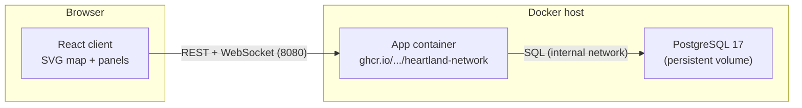

# Heartland Network — Architecture

Heartland Network is a self-hosted, single-player strategy game about building
and operating a statewide broadband network. It ships as **one application
image** (Node.js server + React web client) plus a PostgreSQL database.

## Topology

- **One process**: Express serves the REST API, the WebSocket endpoint, and the
  static client bundle. No separate reverse proxy is required for normal
  deployments (see DEPLOYMENT.md for optional TLS termination).
- **PostgreSQL** is the only stateful service. All game saves live in a
  versioned JSONB column; SQL is limited to migrations and save storage.

## Repositories / packages

| Path | Package | Role |
| --- | --- | --- |
| `packages/shared` | `@heartland/shared` | Types, balance constants, API contract. No runtime deps. |
| `packages/server` | `@heartland/server` | Authoritative simulation, REST API, WebSocket, persistence, migrations. |
| `packages/client` | `@heartland/client` | React SPA: map rendering, panels, HUD. |
| `e2e/` | — | Playwright browser tests (desktop + mobile). |

## Server design

- **Simulation** (`packages/server/src/sim`): pure, deterministic functions.
  A `GameEngine` owns one `GameSave` and advances it one game day per `tick()`.
  Randomness uses a seeded `mulberry32` stream persisted in the save, so
  restarts continue the same random sequence.
- **State** (`state/gameStore.ts`): an in-memory registry of loaded games.
  Each game is persisted to Postgres on manual save, autosave (every N game
  days, default 30), important commands, and graceful shutdown.
- **API** (`api/routes.ts`, `api/ws.ts`):
  - `GET /api/health`, `GET /api/meta`
  - `GET/POST /api/games`, `GET /api/games/:id`
  - `POST /api/games/:id/commands` — validated player commands
  - `POST /api/games/:id/estimate` — server-computed cost previews
  - `POST /api/games/:id/save`, `GET /api/games/:id/export`,
    `POST /api/games/import`, `DELETE /api/games/:id`
  - `WS /api/ws?game=:id` — live state + event push
- **Persistence**: `games` table (`id`, `name`, `save_version`, `data jsonb`,
  timestamps, `playtime_s`). SQL migrations are applied at startup in
  transactions tracked by `schema_migrations`.
- **Save migration**: `GameSave.version` chains through pure upgrade functions
  in `save/migrations.ts`. Loading an old save upgrades it transparently.

## Client design

- React 18 + Vite, no runtime UI libraries. All visuals are original inline
  SVG/CSS.
- **Map** is the center of play: procedural terrain, roads, towns, districts,
  sites, links, coverage, storms. Pan/zoom (mouse, wheel, pinch), context
  menus, tooltips, keyboard shortcuts.
- **Store** (`game/store.tsx`): a small external store consumed via
  `useSyncExternalStore`. REST for actions, WebSocket for live state.
- **Design system** (`theme.css`): dark NOC-style palette, status colors,
  reusable panels/tables/badges/progress bars, responsive layout down to
  phone size.

## Key engineering decisions

1. **Procedural map instead of map tiles** — normal gameplay never calls a
   public map service; the state of "Meridian" is generated from a seed.
2. **Server-authoritative simulation** — clients send commands and render
   state; there is no client-side game logic to desync.
3. **JSONB saves with a version chain** — keeps persistence simple while
   making save compatibility testable (see `test/unit/save-migrations.test.ts`).
4. **Single production image** — client build is served by the server. Only
   PostgreSQL runs beside it.
5. **Deterministic tests** — the engine's random stream is seedable; tests pin
   settings (`ambientStorms`, `equipmentFailures`) where determinism matters.

## Security posture

- No accounts: this is a local single-player game; gameplay requires no cloud
  services of any kind.
- PostgreSQL is on a private Docker network only; the host never exposes it.
- Optional `ADMIN_TOKEN` gates import/delete endpoints for operators who
  expose the service beyond their LAN.
- No embedded secrets; production defaults come from compose (database on a
  private network, every setting overridable via environment variables, no
  `.env` file required).
