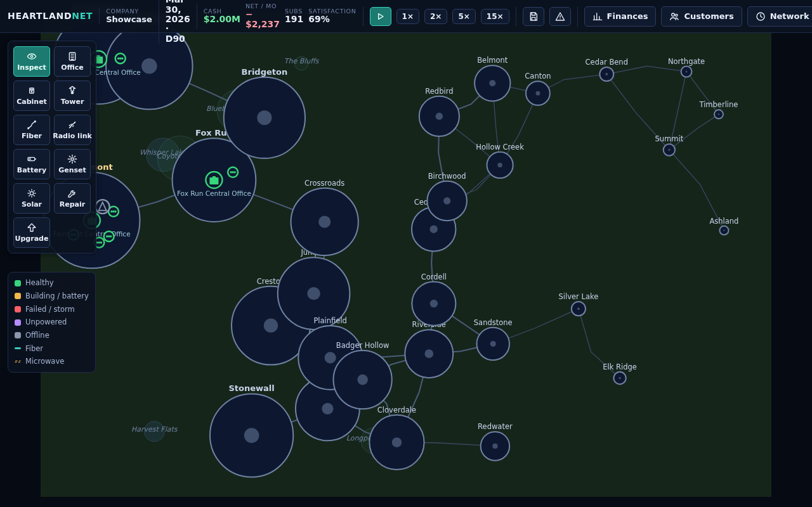
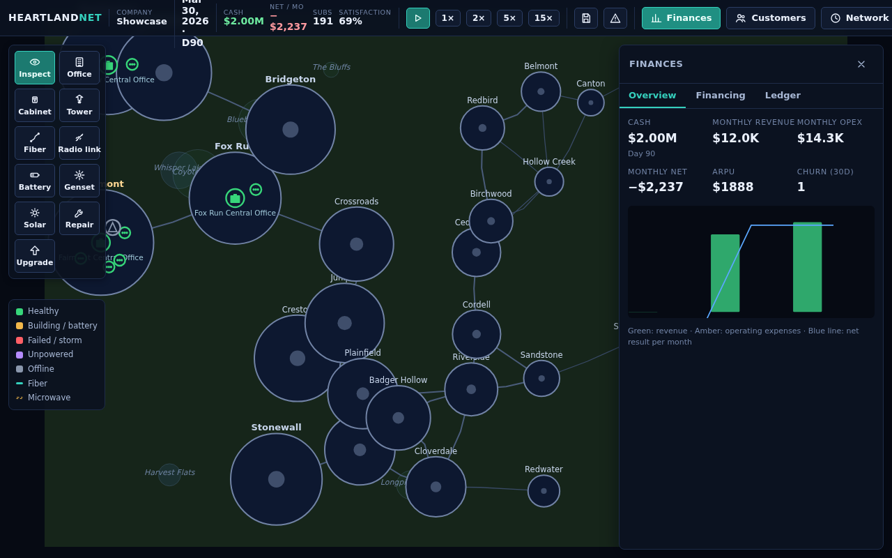

# Heartland Network

**Build and operate a statewide broadband network.** Start with nothing but
seed capital, connect towns across the fictional state of Meridian with fiber
and fixed wireless, keep customers happy through storms and failures, outbid
your rivals, and grow into the region's backbone carrier.

Self-hosted, single-player, no account required. All game logic runs on your
own server; the map is procedurally generated and needs no external services.





## Features

- **Statewide procedural map** — 30 towns, road network, terrain elevations.
- **Full infrastructure play** — central offices, GPON cabinets, fiber trunks,
  towers, microwave backhaul with real terrain line-of-sight.
- **Power & backup** — grid, batteries (runtime hours), generators with fuel
  logistics, solar after research.
- **Failures & redundancy** — equipment failures, cable cuts, storms, repair
  crews, ring topologies and dual homing that actually keep you online.
- **Customers & competition** — household/business demand, plan pricing,
  satisfaction, churn, two AI rivals, marketing campaigns.
- **Finance** — cash flow, monthly P&L, bonds, emergency credit, bankruptcy.
- **Research tree** — 15 technologies unlocking better equipment and perks.
- **Save system** — autosave, export/import, versioned save migration chain.
- **Complete test coverage** — unit, integration, and Playwright E2E tests
  for desktop and mobile viewports.

## Quick start (production, via Docker)

No `.env` file required — the compose file ships safe defaults and the
database is never exposed to the host.

```bash
# 1. Get the compose file
mkdir heartland-network && cd heartland-network
curl -LO https://raw.githubusercontent.com/Atvriders/heartland-network/main/compose.yml
# 2. Launch
docker compose pull
docker compose up -d
# 3. Open http://<docker-host-ip>:8080
```

Optional: to use your own database password (or any other setting), export it
in your shell before `docker compose up -d`, e.g.
`export POSTGRES_PASSWORD='a-long-random-value'`. A `.env` file also works but
is never required.

Health: `http://<host>:8080/api/health`

## Quick start (development)

Requires Node.js ≥ 20 and PostgreSQL (or Docker for the dev compose).

```bash
git clone https://github.com/Atvriders/heartland-network.git
cd heartland-network
npm install
npm run build
npm run dev:server   # DATABASE_URL must point at a PostgreSQL instance
npm run dev:client   # Vite on :5173, proxies /api to :8080
```

## Testing

```bash
npm run typecheck          # TypeScript strict
npm run lint               # ESLint
npm run format:check       # Prettier
npm run test:unit          # Simulation unit tests
npm run test:integration   # Live server + PostgreSQL tests
npm run test:e2e           # Playwright: desktop + mobile workflows
```

## Documentation

- [ARCHITECTURE.md](ARCHITECTURE.md) — how the system is built
- [DATA_MODEL.md](DATA_MODEL.md) — entities and persistence
- [SIMULATION_RULES.md](SIMULATION_RULES.md) — the rules behind the numbers
- [DEPLOYMENT.md](DEPLOYMENT.md) — production deployment
- [BACKUP_AND_RESTORE.md](BACKUP_AND_RESTORE.md) — protecting your saves
- [UPGRADE.md](UPGRADE.md) — updating between versions
- [ROADMAP.md](ROADMAP.md) — project plan and history
- [IMPLEMENTATION_STATUS.md](IMPLEMENTATION_STATUS.md) — status of every system
- [TEST_STATUS.md](TEST_STATUS.md) — test results
- [RELEASE_CHECKLIST.md](RELEASE_CHECKLIST.md) — what "done" means
- [THIRD_PARTY_NOTICES.md](THIRD_PARTY_NOTICES.md) — licenses & attribution

## Gameplay quick reference

| Goal | How |
| --- | --- |
| First revenue | Build a **central office** in a town, then **cabinets** in its districts. |
| Expand | **Fiber** follows roads between offices; **towers** cover towns with line of sight; chain remote towers with **microwave**. |
| Survive storms | Add **batteries + generators**, keep **repair crews** staffed, and dispatch them from the Incidents panel. |
| Avoid congestion | Watch link utilization; upgrade trunks or add routes (rings). |
| Beat rivals | Price plans in Customers, run **campaigns**, keep satisfaction high. |
| Grow faster | Issue **bonds** in Finances, research in the Research panel. |

Shortcuts: `Space` pause · `1–4` speed · `+/-` zoom · `Esc` cancel tool ·
right-click the map for context actions.

## License

MIT — see [LICENSE](LICENSE). All code and original assets in this repository
are original work; third-party components are listed in
[THIRD_PARTY_NOTICES.md](THIRD_PARTY_NOTICES.md).
